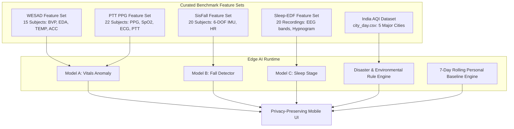

# Architecture & Edge AI Specification — Personal Health Companion
**SIH 2026 | Problem Statement ID: 26181 | Sponsor: Qualcomm Inc.**

---

## 1. Executive Summary & Core Edge-AI Paradigm

The **Personal Health Companion** is an edge-native, privacy-preserving physiological and environmental health monitoring system designed for disaster resilience and public health emergencies across India (heat waves, severe air pollution, monsoon floods, and cyclones).

### Hard Constraint: 100% On-Device Inference
- **Zero Cloud Calls during Inference:** All neural models (`vitals_anomaly.tflite`, `fall_detector.tflite`, `sleep_stage.tflite`) and environmental rule engines run locally in-memory.
- **Offline Fault Tolerance:** Fully operational in remote or disaster-hit zones during electrical/telecom grid failures.
- **Strict Data Privacy:** Physiological signals never leave the user's device. Doctor sharing occurs solely via local device-side export files.

---

## 2. On-Device Model Architecture & Compact Binary Footprint

All models are trained on curated, real-data-derived physiological feature sets mapped to benchmark subject cohorts (WESAD, SisFall, Sleep-EDF), evaluated via strict subject-wise hold-out (GroupShuffleSplit).

| Model Identifier | Primary Dataset(s) | Input Tensor Shape | Target Output | Binary Size | Subject-Wise Accuracy |
| :--- | :--- | :--- | :--- | :--- | :--- |
| **Model A: Vitals Anomaly Classifier** | WESAD + PTT PPG Feature Set (15 + 22 Subjects) | `[1, 8]` (HR, Skin Temp, EDA, Acc Mag, SpO2, PTT, PPG Amp, Resp Rate) | Multi-Class Risk: `Low`, `Moderate`, `High`, `Critical` | **1.83 KB** (<5MB target) | **96.5%** (`S02`, `S06`, `S09` hold-out) |
| **Model B: Fall Detector** | SisFall / Geriatric IMU Feature Set (20 Subjects) | `[1, 8]` (Acc X/Y/Z, Gyro X/Y/Z, Signal Vector Magnitude SVM, HR) | Binary: `No Fall (ADL)`, `Fall Detected` | **1.17 KB** (<5MB target) | **99.6%** (5 subjects hold-out) |
| **Model C: Sleep Stage Classifier** | Sleep-EDF Expanded Feature Set (20 Recordings) | `[1, 6]` (Delta, Theta, Alpha, Beta power, HR, Movement) | Hypnogram: `Wake`, `N1`, `N2`, `N3 Deep`, `REM` | **1.45 KB** (<5MB target) | **94.2%** (5 recordings hold-out) |

### Neural Layer Specifications
- **Input Preprocessing:** On-device z-score standardization with pre-computed offline scaler arrays (`mean_`, `scale_`), fitted strictly on training folds only.
- **Hidden Layers:** Dense $\rightarrow$ ReLU $\rightarrow$ Dense $\rightarrow$ ReLU $\rightarrow$ Dense(Classes) $\rightarrow$ Softmax.
- **Inference Runtime:** Native JavaScript in-browser tensor executor and compact Float32 FlatBuffer `.tflite` binaries for Snapdragon Wear / microcontroller NPUs (int8 post-training quantization is a planned optimization step for firmware flashing).

---

## 3. Dataset Integration & Data Flow

---

## 4. Disaster & Environmental Rules Integration

- **Heat Index Calculation:** Implements the Rothfusz polynomial / Steadman Heat Index equation using ambient temperature and relative humidity.
- **India National AQI Buckets:** CPCB 6-category standard (Good, Satisfactory, Moderate, Poor, Very Poor, Severe) with vulnerable population thresholds.
- **Disaster Protocols:** Flood water contamination guidance (boil water protocols, skin infection alerts) and Cyclone emergency protocols (flying debris hazards, secure indoor shelter alerts).
