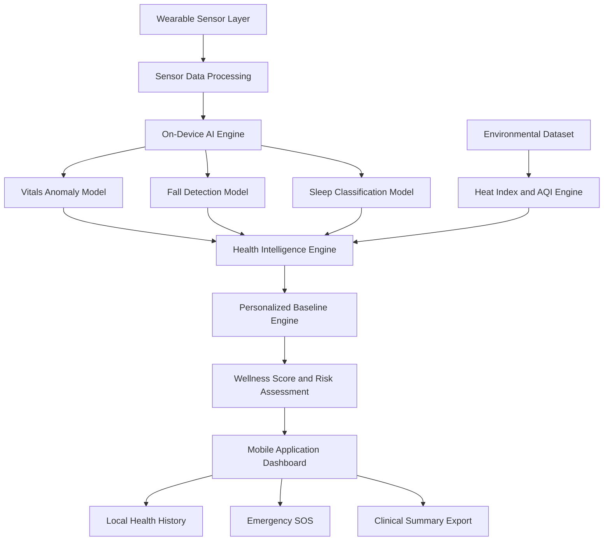

# APEX-BAND
### Edge-AI Powered Personal Health Companion for Public Health Resilience

<p align="center">
  <b>Intelligent Health Monitoring • On-Device AI • Disaster Resilience • Privacy-First Computing</b>
</p>

<p align="center">
  <a href="https://github.com/anishwathvs/APEX-BAND">GitHub Repository</a> •
  <a href="https://app-self-nine-81.vercel.app/">Live Demo</a>
</p>

---

## 1. Overview

**APEX-BAND** is an AI-powered personal health companion designed to monitor physiological conditions, identify potential health anomalies, detect falls, analyze sleep patterns, and provide environmental risk advisories.

The project addresses a critical challenge in public health: conventional cloud-dependent health monitoring systems may become unavailable during natural disasters, network failures, and emergency situations.

APEX-BAND takes an **edge-first approach**, executing compact machine learning models locally on the user's device. This enables health analysis without requiring continuous internet connectivity or transmitting sensitive physiological information to cloud servers.

Developed for **Smart India Hackathon 2026 – Problem Statement 26181**, sponsored by Qualcomm.

### The Problem

People living in disaster-prone and environmentally vulnerable regions face several health risks:

- Extreme heat waves that can cause heat exhaustion and heat stroke.
- Severe air pollution that increases respiratory and cardiovascular risks.
- Floods and cyclones that disrupt healthcare access and communication networks.
- Falls and sudden physiological abnormalities among elderly and vulnerable individuals.
- Limited connectivity in rural and disaster-affected locations.

### Our Solution

APEX-BAND combines wearable sensor concepts, lightweight machine learning models, environmental intelligence, and a privacy-preserving application to provide continuous health insights, even in offline environments.

---

## 2. Key Features

| Feature | Description |
|---|---|
| AI Vital Monitoring | Analyzes physiological features to identify health-risk categories. |
| Fall Detection | Uses motion and heart-rate features to identify potential falls. |
| Sleep Analysis | Classifies sleep into five stages and evaluates restorative sleep. |
| Heat Stress Monitoring | Calculates heat index and identifies environmental thermal risks. |
| Air Quality Intelligence | Provides city-based AQI risk information using offline datasets. |
| Personalized Health Baselines | Compares current readings against a rolling seven-day personal baseline. |
| Wellness Score | Calculates a composite wellness score from multiple health indicators. |
| Emergency SOS | Provides a fall-related emergency countdown with cancellation support. |
| Offline Operation | Runs the inference and environmental rule engines locally. |
| Clinical Summary Export | Generates downloadable health summaries for review by a healthcare professional. |
| Privacy-First Design | Keeps personal health information on the user's device. |

---

## 3. AI/ML Architecture

APEX-BAND incorporates three compact neural network models designed for efficient edge inference.

### Model A – Vitals Anomaly & Risk Classification

**Purpose:** Identify potential physiological abnormalities and categorize health risk.

- Input: Eight physiological features.
- Architecture: Dense Neural Network with ReLU and Softmax.
- Dataset basis: WESAD and PTT/PPG feature sets.
- Output: Low, Moderate, High, and Critical.
- Exported model size: 1.83 KB.
- Reported subject-wise hold-out accuracy: 96.45%.

### Model B – Intelligent Fall Detection

**Purpose:** Identify sudden falls using motion-related and physiological features.

- Input: Eight features involving acceleration, gyroscope, signal vector magnitude, and heart rate.
- Architecture: Dense Neural Network.
- Dataset basis: SisFall.
- Output: Fall Detected or No Fall.
- Exported model size: 1.17 KB.
- Reported subject-wise hold-out accuracy: 99.62%.

### Model C – Sleep Stage Classification

**Purpose:** Analyze sleep-related features and identify different sleep stages.

- Input: Six features, including EEG frequency-band powers, heart rate, and movement.
- Architecture: Dense Neural Network.
- Dataset basis: Sleep-EDF Expanded.
- Output: Wake, N1, N2, N3 Deep, and REM.
- Exported model size: 1.45 KB.
- Reported recording-wise hold-out accuracy: 94.16%.

### Model Performance Summary

| Model | Accuracy | Model Size |
|---|---:|---:|
| Vitals Anomaly Classifier | 96.45% | 1.83 KB |
| Fall Detector | 99.62% | 1.17 KB |
| Sleep Stage Classifier | 94.16% | 1.45 KB |

*These are reported offline benchmark evaluation results using subject-wise or recording-wise hold-out validation. They are not clinical validation results.*

### Edge Inference

The application uses a lightweight JavaScript neural inference executor to perform matrix operations and Softmax calculations locally.

The compact model weights are exported from trained models and executed in the browser without requiring remote inference APIs.

This architecture is designed to support future deployment on embedded hardware and Qualcomm wearable platforms.

---

## 4. System Architecture



### Core Processing Engines

- **On-Device Inference Engine:** Executes compact neural networks locally.
- **Personal Baseline Engine:** Calculates rolling mean, standard deviation, and individualized z-score deviations.
- **Environmental Intelligence Engine:** Uses the Steadman Heat Index calculation and offline AQI datasets.
- **Wellness Engine:** Combines cardiovascular stability, oxygenation, sleep, and environmental stress.
- **Recommendation Engine:** Maps detected conditions to predefined safety and health advisories.

---

## 5. Technology Stack

| Category | Technologies |
|---|---|
| Frontend | React, JavaScript, HTML, CSS |
| UI & Animation | Framer Motion, SVG |
| Machine Learning | Python, Scikit-learn, MLPClassifier |
| Model Deployment | TensorFlow Lite, JavaScript inference executor |
| Data Processing | NumPy, Pandas |
| Local Persistence | Browser LocalStorage |
| Embedded Hardware Target | ESP32-S3 |
| Wearable Sensors Target | MAX30102, MPU6050 |
| Connectivity Roadmap | Bluetooth Low Energy (BLE) |
| Deployment | Vercel |

---

## 6. Application Modules

### 1. Live Health Monitoring
- Heart-rate and SpO2 monitoring interface.
- Temperature and sleep information.
- Animated PPG waveform visualization.
- AI-based health-risk classification.

### 2. Environmental & Disaster Alerts
- Heat index assessment.
- Air quality information.
- City-based environmental risk lookup.
- Vulnerable-user profile support.

### 3. Emergency SOS
- Fall detection interface.
- Emergency countdown mechanism.
- Cancellation option.
- Transparent simulation status.

### 4. Health Analytics Dashboard
- Seven-day health trends.
- Personalized baseline comparisons.
- Risk indicators.
- Historical alert information.

### 5. Settings & Clinical Summary
- Sensor tracking controls.
- AI model information.
- Clinical summary export.
- Local data deletion.

---

## 7. Repository Structure

```text
APEX-BAND/
│
├── android/
│   └── app/
│       └── src/
│           └── main/
│
├── app/
│   ├── src/
│   │   ├── inference/
│   │   ├── screens/
│   │   └── components/
│   └── public/
│
├── data/
│   ├── wesad_subset.csv
│   ├── fall_detection_subset.csv
│   ├── sleep_edf_subset.csv
│   ├── ptt_ppg_subset.csv
│   └── india_aqi_city_day_subset.csv
│
├── firmware/
│   └── esp32_s3_ble_sos/
│
├── models/
│   └── exported/
│       ├── vitals_anomaly.tflite
│       ├── fall_detector.tflite
│       └── sleep_stage.tflite
│
├── ARCHITECTURE.md
├── PROJECT_OVERVIEW.md
├── AUDIT_REPORT.md
├── TRAINING_EVIDENCE.md
├── DEMO_SCRIPT.md
├── DEPLOYMENT_SCENARIOS.md
└── README.md
```

*This is a logical overview of the repository; consult the actual directory contents for the complete file listing.*

---

## 8. Getting Started

### Prerequisites

- Node.js
- npm
- Git

### Clone the Repository

```bash
git clone https://github.com/anishwathvs/APEX-BAND.git

cd APEX-BAND
```

### Install Dependencies

```bash
npm install
```

### Run the Development Server

```bash
npm run dev
```

Use the local URL printed by the development server to access the application.

### Build for Production

```bash
npm run build
```

---

## 9. Implementation Status & Hardware Roadmap

APEX-BAND currently has a working browser-based application with local AI inference and simulated sensor telemetry.

| Component | Current Status |
|---|---|
| AI model training and evaluation | Implemented |
| JavaScript on-device inference | Implemented |
| Health-risk classification | Implemented |
| Fall detection inference | Implemented |
| Sleep-stage classification | Implemented |
| Environmental risk engine | Implemented |
| Seven-day personal baseline | Implemented |
| Local persistence | Implemented |
| Browser-based application | Implemented |
| Sensor telemetry | Simulated |
| Live Bluetooth wearable connection | Planned |
| Physical ESP32-S3 sensor integration | Planned |
| Native emergency SMS dispatch | Planned |
| Bluetooth Mesh disaster relay | Planned |

### Future Enhancements

1. Integrate MAX30102 and MPU6050 sensors with ESP32-S3.
2. Implement Bluetooth Low Energy communication between the wearable and companion application.
3. Deploy compact models using TensorFlow Lite for Microcontrollers.
4. Integrate native emergency SMS and GPS functionality.
5. Explore Bluetooth Mesh communication for disaster-response environments.
6. Extend compatibility with Qualcomm Snapdragon Wear platforms.

---

## 10. Privacy & Safety

Privacy is a core design principle of APEX-BAND.

- Physiological inference runs locally in the current application.
- Personal health data is stored in local device storage.
- No cloud-based health inference is required.
- Users can delete locally stored application data.
- Clinical summaries can be exported locally.

**Medical Disclaimer:** APEX-BAND is an experimental engineering and research prototype. It is not a certified medical device and must not be used as a substitute for professional medical diagnosis, treatment, or emergency services. Model performance on benchmark datasets does not establish clinical safety or effectiveness.

---

## 11. Project Information

| Detail | Information |
|---|---|
| Project | APEX-BAND |
| Domain | Artificial Intelligence / Healthcare / IoT |
| Competition | Smart India Hackathon 2026 |
| Problem Statement | 26181 |
| Sponsor | Qualcomm Inc. |
| Primary Focus | Edge AI and Public Health Resilience |
| Developer | Anishwath VS |

---

## 12. Links

- **GitHub Repository:** https://github.com/anishwathvs/APEX-BAND
- **Live Application:** https://app-self-nine-81.vercel.app/
- **Architecture Documentation:** [ARCHITECTURE.md](ARCHITECTURE.md)
- **Project Overview:** [PROJECT_OVERVIEW.md](PROJECT_OVERVIEW.md)
- **Model Training Evidence:** [TRAINING_EVIDENCE.md](TRAINING_EVIDENCE.md)
- **Audit Report:** [AUDIT_REPORT.md](AUDIT_REPORT.md)

---

<p align="center">
  <b>APEX-BAND — Bringing Intelligent Health Monitoring Closer to Everyone.</b>
  <br>
  Built with a vision for privacy-preserving AI and resilient public health.
</p>
